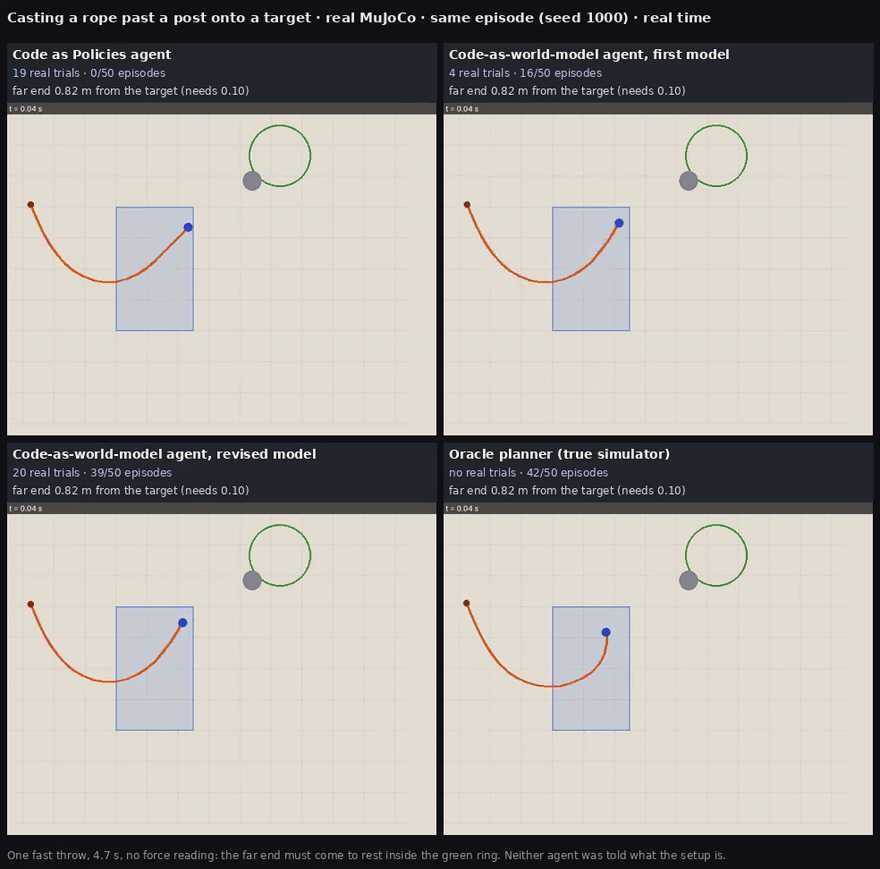
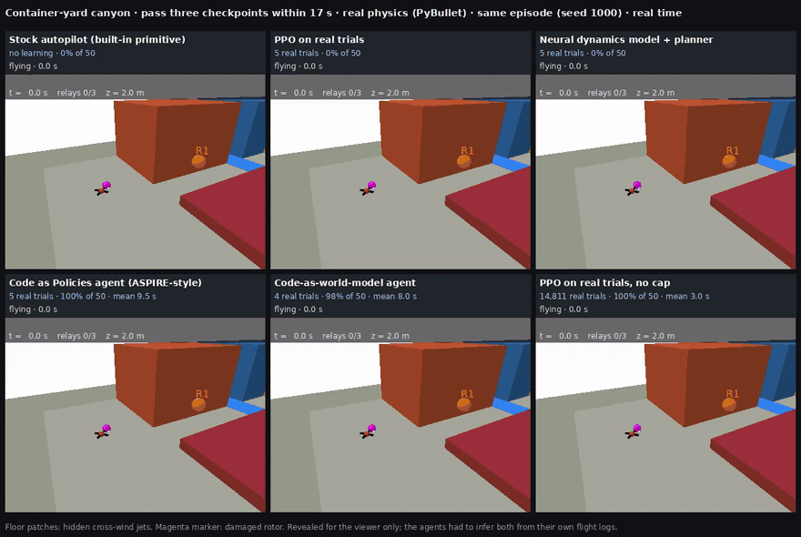
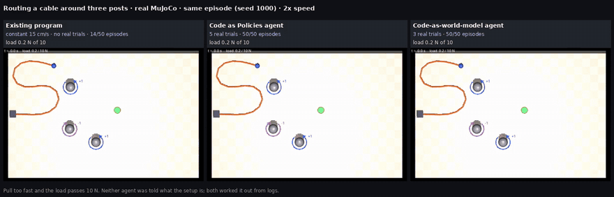
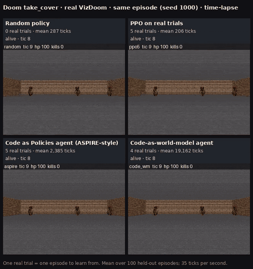
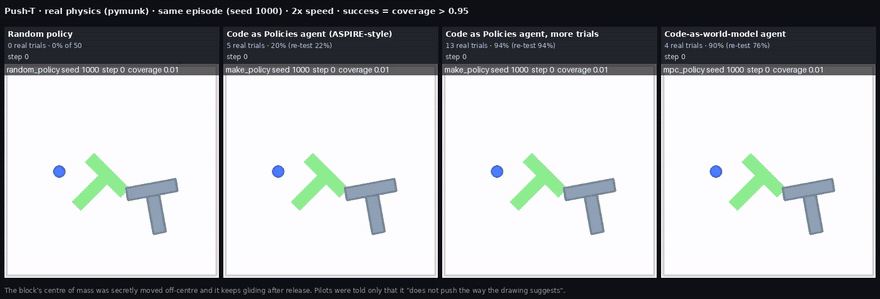
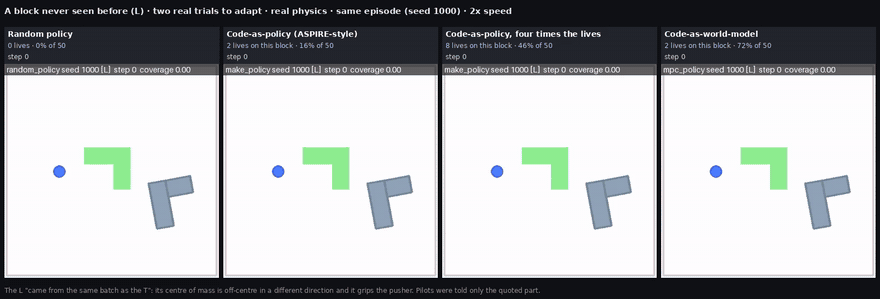
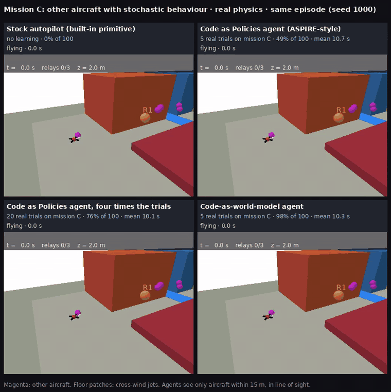

# World Models as Unit Tests

Code as World Models: agents observe their task environment, write its world model as code, and use it to help write and verify policies, including Code-as-Policies programs

**[Read the full write-up →](https://dongzhezheng.github.io/world-models-as-unit-tests/)** · **[Interactive Space](https://huggingface.co/spaces/DenzelZheng/world-models-as-unit-tests)** · **[Dataset](https://huggingface.co/datasets/DenzelZheng/world-models-as-unit-tests)**

<p align="center"></p>

## What this is about

When a coding agent writes robot controllers, every new version needs testing, and testing means a real trial. Five real trials prove little: all five succeeding puts the true success rate above 55% at 95% confidence. We explored whether the agent can build its own tests in code, from a handful of real trials, and use them to verify programs before deployment.

The idea is straightforward: the agent writes a world model as a small Python file (249 to 412 lines, 14 to 26 KB), fits its parameters to its own observation logs, and runs candidate controllers inside the model. The world model plays the role that unit tests play for ordinary code. These tests can be wrong: they ranked programs well and overestimated absolute success. Across 34 programs from five tasks, the predicted and real success rates correlated at r = 0.97 (MAE 5.2 percentage points).

We tried this across eight tasks in four simulators (VizDoom, a quadrotor in PyBullet/PyFlyt, planar pushing in pymunk, cable and rope manipulation in MuJoCo), with each agent capped at five real trials per task. These runs suggest that a world model may not need to be a neural network trained on thousands of rollouts. A Python file of a few hundred lines, fitted on the spot from the agent's own experiments, may serve as the unit-test layer between code generation and physical deployment. In our runs, files of this size came close to a planner that had the true simulator: 78% on the rope throw against the oracle planner's 84%, and 84% held-out on the unseen L-shaped block (a CaP program from 8 real trials, selected with the tests) against the oracle planner's 80%.

## The tasks in motion

Each GIF compares controllers side by side on the same real episode. Full-quality videos are on the [project page](https://dongzhezheng.github.io/world-models-as-unit-tests/).

<p align="center"></p>

**Drone, fixed route (mission A).** Six controllers on the same episode. Hidden wind zones and the damaged rotor are drawn for the viewer. The stock autopilot, PPO with 5 real trials and the neural dynamics model with 5 real trials crash. The CaP agent finishes in 9.4 s, the world-model agent in 8.0 s. PPO with 14,811 real trials finishes in 2.9 s.

<p align="center"></p>

**Cable routing.** Three programs on the same episode: an existing constant-speed program, the CaP agent (5 real trials, 50/50) and the world-model agent (3 real trials, 50/50). Pulling too fast overloads the cable.

<p align="center"></p>

**Doom survival.** Four controllers in the same episode, time-lapse. Random dies at tick 680, PPO (5 real trials) at 270, the CaP agent at 2,533. The world-model agent's controller is still alive at tick 3,000. That episode ran 24,421 ticks.

<p align="center"></p>

**Push-T.** Pushing a T-shaped block with a secretly moved centre of mass. Random. The CaP agent with 5 real trials times out at 0.94 coverage (the threshold is above 0.95). The CaP agent with 13 real trials solves it. The world-model agent with 4 real trials solves it.

<p align="center"></p>

**Push-L (unseen shape).** A new block the agents had not met before (they had two real trials on it). Random and the CaP agent with 2 real trials do not solve it. The CaP agent with 8 real trials solves it at step 295 of 300. The world-model agent's controller solves it at step 152.

<p align="center"></p>

**Drone with traffic (mission C).** Seven to eight random other aircraft. The stock autopilot and the CaP agent with 5 real trials crash. The CaP agent with 20 real trials finishes. The world-model agent with 5 real trials finishes by climbing over the traffic and descending to each checkpoint.

<p align="center"></p>

**Rope throw.** Four programs on the same episode (seed 1000). The CaP agent after 19 real trials (0/50) comes to rest 1.12 m from the target. The world-model agent's first model (4 real trials, 16/50) is still moving at the time limit. Its revised model (20 real trials, 39/50) comes to rest inside the target after 2.22 s. The oracle planner with the true simulator (42/50) comes to rest after 1.94 s.

## What is in this repository

| Directory | Contents |
|-----------|----------|
| `reallab/` | The eight task environments (simulators standing in for the real system): `doom/`, `drone/` (three missions), `pusht/` (T and L blocks), `station/` (cable routing), `annex/` (rope throw) |
| `worlds/` | The world models the world-model agents wrote, one Python file each (249 to 412 lines) |
| `pilots/` | The CaP agents' programs, every version |
| `experiments/<task>/code_wm/` | The world-model agents' own scripts and controllers |
| `experiments/audit/` | Re-evaluation scripts for held-out seeds, model-based evaluation, figures and videos |
| `cawm/` | Shared code: budget counter for real trials, result records, MPC, PPO |
| `runs/` | Recorded results, fitted parameters, the agents' hypothesis and diagnosis files, real-trial logs |
| `blog/`, `site/` | Page sources |
| `assets/` | README images |
| `space/` | Sources of the Hugging Face Space: the static page builder, the recorded runs it replays, and a live variant that runs programs on a server (not deployed) |
| `dataset/` | Scripts that build and check the Hugging Face dataset |
| `harness/` | A small harness for trying this procedure on your own environment ([README](harness/README.md)) |
| `tests/` | Test suite |

**Record names.** `aspire_style` = the CaP agent (modelled on ASPIRE, five-trial budget); `code_wm` = the world-model agent; `cap_in_code_world` = the CaP agent using the world model as its tests; `*_extended` = runs with more real trials. "Lives" in file names and code = real trials.

## Install

Verified on Linux x86\_64, Python 3.12, with an NVIDIA GPU. A GPU is optional according to the code: only the cable and rope world-model controllers use it (via PyTorch).

```bash
uv venv --python 3.12 .venv && uv pip install --python .venv/bin/python -r requirements.txt
```

52 s in our check. The plain `venv`/`pip` equivalent is at the top of `requirements.txt`.

Then run the test suite:

```bash
python -m pytest tests reallab -q
```

111 tests, about 1 minute.

## Reproduce

```bash
python reproduce.py list
```

Lists every registered (task, controller) pair with its recorded result. Tasks: `doom`, `drone_A`, `drone_B`, `drone_C`, `pusht_T`, `pusht_L`, `cable`, `rope`. 46 registered controllers.

```bash
python reproduce.py real <task> <controller>
python reproduce.py world <task>
```

The environments are deterministic given the seed. Every re-run with a per-episode record matched it episode by episode. Commands we verified (8 workers):

| Command | Reproduced | Recorded | Time |
|---------|-----------|----------|------|
| `real rope aspire_style` | 1/50 | 1/50 | 5 s |
| `real rope aspire_style_extended` | 0/50 | 0/50 | 4 s |
| `real cable aspire_style` | 50/50 | 50/50 | 10 s |
| `real cable code_wm` | 50/50 | 50/50 | 16 s |
| `real pusht_L cap_in_code_world` | 42/50 | 42/50 | 1 s |
| `real drone_C cap_in_code_world` | 95/100 | 95/100 | 8 s |
| `real doom aspire_style` | 2,384.56 game ticks | 2,384.56 | 7 s |
| `world pusht` (15 programs, 3,000 episodes) | all 15 equal to the record | | 35 s |
| `world cable` (23 programs) | all equal | | 214 s |
| `real rope code_wm --episodes 4` | 1/4, same episodes as the record | (16/50 over all 50) | 125 s |
| `real rope code_wm_extended --episodes 4` | 3/4, same episodes as the record | (39/50 over all 50) | 257 s |

The two rope world-model controllers take about 25 and 50 minutes for all 50 episodes. We re-ran only 4 episodes each in this check.

## Harness

`harness/` is a small framework for trying this procedure on your own environment. You bring a Python environment object and a TOML config. The harness gives a coding agent a workspace, a brief, a trial budget and a client for the environment, then scores the delivered controller against held-out seeds in both the delivered world model and the real environment. No model has been run through it by us. See [`harness/README.md`](harness/README.md) for setup and examples.

## What is not here

The LLM agent runs themselves are not re-run by this repository: the programs and world models they wrote are included as files. Evaluation step logs and most videos are left out for size. Each agent ran once per task. The simulators stand in for real systems.

## How the files were produced

Claude Fable 5.2 assigned tasks and checked isolation rules. Claude Opus 5.5 ran both agents (the world-model agent and the CaP agent). Claude Sonnet 5.5 built the environments (cable environment: Claude Opus 5.5). Claude Opus 4.6 wrote the documents. Each agent was restricted by instruction to its environment's documented interface and its own trial logs; afterwards all command logs were scanned and no agent had read files outside its allowed set. Two exceptions by design: the CaP agent in the two "world model as its tests" runs was given the world model the other agent had written, and on the cable task both agents were given 10 logged episodes.

## The page

Build locally (standard library only):

```bash
python site/build.py _site
```

A GitHub Actions workflow (`.github/workflows/pages.yml`) deploys the page to [dongzhezheng.github.io/world-models-as-unit-tests](https://dongzhezheng.github.io/world-models-as-unit-tests/).

## Citation

```bibtex
@misc{cawm2026,
  title       = {World Models as Unit Tests},
  author      = {Denzel Zheng},
  institution = {Princeton University},
  year        = {2026},
  note        = {Early research note. Simulators stand in for
                 reality; one run per agent per task; results
                 are not peer-reviewed.}
}
```

## Licence

MIT. See [LICENSE](LICENSE).

## About this note

This is an early exploration, shared so it can be discussed and corrected. If anything here is confused or wrong, we would like to hear about it. We welcome questions, objections and corrections so we can improve it together.
