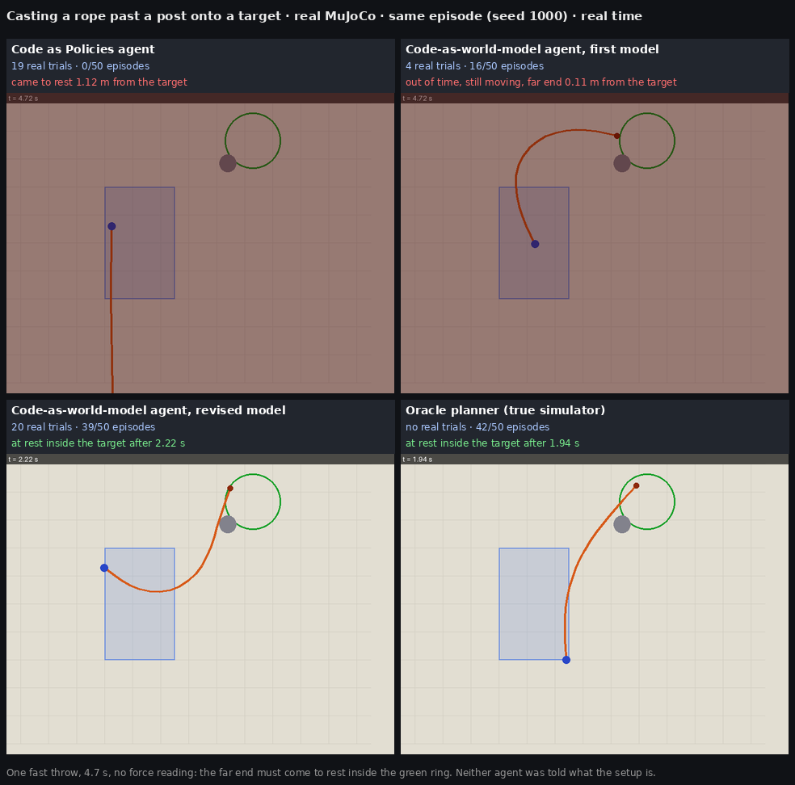

# World Models as Unit Tests

Code as World Models: agents observe their task environment, write its world model as code, and use it to help write and verify policies, including Code-as-Policies programs

Denzel Zheng · Mechanical and Aerospace Engineering (MAE), Princeton University · November 2026

**[Read the full write-up →](https://dongzhezheng.github.io/world-models-as-unit-tests/)**
&ensp;|&ensp;
[中文 README](README.zh.md)
&ensp;|&ensp;
[中文 NEWS](NEWS.zh.md)

<p align="center"></p>

## What this is about

When a coding agent writes robot controllers, every new version needs testing, and testing means a real trial. Five real trials prove little: all five succeeding puts the true success rate above 55% at 95% confidence. We explored whether the agent can build its own tests in code, from a handful of real trials, and use them to verify programs before deployment.

The idea is straightforward: the agent writes a world model as a small Python file (249 to 412 lines, 14 to 26 KB), fits its parameters to its own observation logs, and runs candidate controllers inside the model. The world model plays the role that unit tests play for ordinary code. These tests can be wrong: they ranked programs well and overestimated absolute success. Across 34 programs from five tasks, the predicted and real success rates correlated at r = 0.97 (MAE 5.2 percentage points).

We tried this across eight tasks in four simulators (VizDoom, a quadrotor in PyBullet/PyFlyt, planar pushing in pymunk, cable and rope manipulation in MuJoCo), with each agent capped at five real trials per task. These runs suggest that a world model may not need to be a neural network trained on thousands of rollouts. A Python file of a few hundred lines, fitted on the spot from the agent's own experiments, may serve as the unit-test layer between code generation and physical deployment. In our runs, files of this size came close to a planner that had the true simulator: 78% on the rope throw against the oracle planner's 84%, and 84% held-out on the unseen L-shaped block against the oracle planner's 80%.

## What is in this repository

| Directory | Contents |
|-----------|----------|
| `reallab/` | The eight task environments (simulators standing in for the real system): `doom/`, `drone/` (three missions), `pusht/` (T and L blocks), `station/` (cable routing), `annex/` (rope throw) |
| `worlds/` | The world models the world-model agents wrote, one Python file each (249 to 412 lines) |
| `pilots/` | The CaP agents' programs, every version |
| `experiments/<task>/code_wm/` | The world-model agents' own scripts and controllers |
| `experiments/audit/` | Re-evaluation scripts for held-out seeds, model-based evaluation, figures and videos |
| `cawm/` | Shared code: budget counter for real trials, result records, MPC, PPO |
| `runs/` | Recorded results, fitted parameters, the agents' hypothesis and diagnosis files, real-trial logs |
| `blog/`, `site/` | Page sources |
| `tests/` | Test suite |

**Record names.** `aspire_style` = the CaP agent (modelled on ASPIRE, five-trial budget); `code_wm` = the world-model agent; `cap_in_code_world` = the CaP agent using the world model as its tests; `*_extended` = runs with more real trials. "Lives" in file names and code = real trials.

## Install

Verified on Linux x86\_64, Python 3.12, with an NVIDIA GPU. A GPU is optional according to the code: only the cable and rope world-model controllers use it (via PyTorch).

```bash
uv venv --python 3.12 .venv && uv pip install --python .venv/bin/python -r requirements.txt
```

52 s in our check. The plain `venv`/`pip` equivalent is at the top of `requirements.txt`.

Then run the test suite:

```bash
python -m pytest tests reallab -q
```

111 tests, about 1 minute.

## Reproduce

```bash
python reproduce.py list
```

Lists every registered (task, controller) pair with its recorded result. Tasks: `doom`, `drone_A`, `drone_B`, `drone_C`, `pusht_T`, `pusht_L`, `cable`, `rope`. 46 registered controllers.

```bash
python reproduce.py real <task> <controller>
python reproduce.py world <task>
```

The environments are deterministic given the seed. Every re-run with a per-episode record matched it episode by episode. Commands we verified (8 workers):

| Command | Reproduced | Recorded | Time |
|---------|-----------|----------|------|
| `real rope aspire_style` | 1/50 | 1/50 | 5 s |
| `real rope aspire_style_extended` | 0/50 | 0/50 | 4 s |
| `real cable aspire_style` | 50/50 | 50/50 | 10 s |
| `real cable code_wm` | 50/50 | 50/50 | 16 s |
| `real pusht_L cap_in_code_world` | 42/50 | 42/50 | 1 s |
| `real drone_C cap_in_code_world` | 95/100 | 95/100 | 8 s |
| `real doom aspire_style` | 2,384.56 game ticks | 2,384.56 | 7 s |
| `world pusht` (15 programs, 3,000 episodes) | all 15 equal to the record | | 35 s |
| `world cable` (23 programs) | all equal | | 214 s |
| `real rope code_wm --episodes 4` | 1/4, same episodes as the record | (16/50 over all 50) | 125 s |
| `real rope code_wm_extended --episodes 4` | 3/4, same episodes as the record | (39/50 over all 50) | 257 s |

The two rope world-model controllers take about 25 and 50 minutes for all 50 episodes. We re-ran only 4 episodes each in this check.

## What is not here

The LLM agent runs themselves are not re-run by this repository: the programs and world models they wrote are included as files. Evaluation step logs and most videos are left out for size. Each agent ran once per task. The simulators stand in for real systems.

## How the files were produced

Claude Fable 5.2 assigned tasks and checked isolation rules. Claude Opus 5.5 ran both agents (the world-model agent and the CaP agent). Claude Sonnet 5.5 built the environments (cable environment: Claude Opus 5.5). Claude Opus 4.6 wrote the documents. Each agent was restricted by instruction to its environment's documented interface and its own trial logs; afterwards all command logs were scanned and no agent had read files outside its allowed set. Two exceptions by design: the CaP agent in the two "world model as its tests" runs was given the world model the other agent had written, and on the cable task both agents were given 10 logged episodes.

## The page

Build locally (standard library only):

```bash
python site/build.py _site
```

A GitHub Actions workflow (`.github/workflows/pages.yml`) deploys the page to [dongzhezheng.github.io/world-models-as-unit-tests](https://dongzhezheng.github.io/world-models-as-unit-tests/).

## Citation

```bibtex
@misc{cawm2026,
  title       = {World Models as Unit Tests},
  author      = {Denzel Zheng},
  institution = {Princeton University},
  year        = {2026},
  note        = {Early research note. Simulators stand in for
                 reality; one run per agent per task; results
                 are not peer-reviewed.}
}
```

## Licence

MIT. See [LICENSE](LICENSE).

## About this note

This is an early exploration, shared so it can be discussed and corrected. If anything here is confused or wrong, we would like to hear about it. We welcome questions, objections and corrections so we can improve it together.
